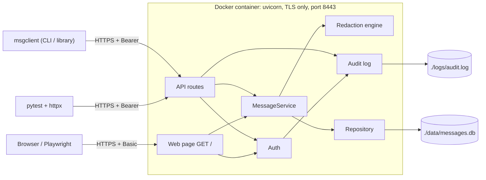

# Design notes

The main decisions behind the service, and why. See the [README](../README.md) for how to run it.

## Architecture

One container runs a FastAPI app under uvicorn on HTTPS. Every write passes through the redaction engine before it reaches SQLite, so storage and the web page only ever see redacted text.

## Decisions

- **Redaction happens once, on write.** `MessageService.create` stores only the redacted text, so the database, the API and the page can never show a raw value. The original text is not logged or kept anywhere.
- **Detection = regex + validator.** The regex finds candidates; a validator confirms them: the JWT header must decode to JSON with `alg`, IPv4 octets must be 0–255, emails need a letter TLD, card numbers must pass the Luhn check. Patterns run in a fixed order (JWT first), and placeholders contain no digits, dots or `@`, so one replacement can't be re-matched by a later pattern.
- **Email matching is deliberately permissive before the `@`.** Missing an email leaks data; over-matching only hides harmless text.
- **Two auth mechanisms, one per caller.** Programs use Bearer tokens; the browser uses HTTP Basic. Passwords are bcrypt-hashed (cost 12); tokens are long random strings stored as SHA-256 and compared in constant time. Unknown usernames still run a bcrypt check, so response time doesn't reveal which users exist. The page is read-only and every change requires a Bearer token, which browsers never attach on their own, so there is no CSRF exposure.
- **Validation errors never echo input.** FastAPI's default 422 response includes the rejected value, which would return unredacted content; the handler in `main.py` returns only the location and reason.
- **Secrets stay out of the image.** Certificates, `users.json` and the database are mounted as volumes, so the same image runs anywhere with its own configuration.
- **Hard delete, by choice.** The brief asks for a delete operation with no audit or undo requirement, so `DELETE` removes the row. Soft delete (a `deleted_at` column) would keep data the user asked to remove, and every query would have to filter it out, where one missed filter brings deleted messages back. If an audit trail or undo were needed, I'd add soft delete with a scheduled purge after a retention period.
- **Audit log instead of keeping deleted data.** Each message creation, deletion (with who deleted it) and failed login is recorded as one line, e.g. `2026-10-22T18:00:05Z AUDIT message.deleted id=42 by=alice`. Message content, passwords and tokens are never logged, and values from the request are sanitized so they can't fake extra log lines. Successful logins are not logged: with HTTP Basic the browser resends the password on every request, so that would log every page view; what's recorded is failed attempts and what users change. Lines are written to the server's output and to `logs/audit.log`, which is on a volume like the database, so the trail survives restarts, rebuilds and `docker compose down`. The file rotates at 5 MB, keeping 3 old copies. In production this would go to a central log store.
- **Shared message board.** Any authenticated user can list, view and delete all messages; each message records its `author`. The brief asks for authentication, not per-user permissions, so authorization is intentionally out of scope.
